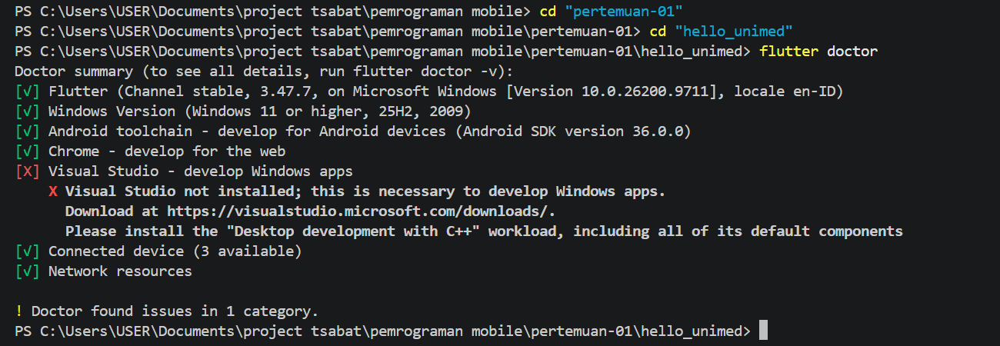
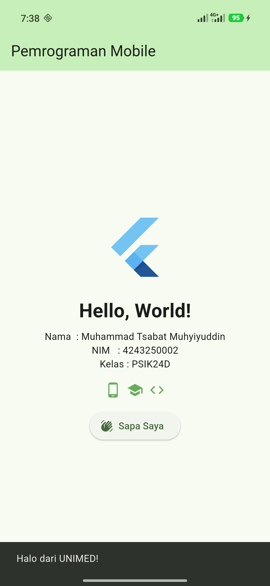

# Tugas Rutin 1 — Setup Environment & Hello World Flutter

Pemrograman Mobile (3KOM40215) · Pertemuan 1 · Ilmu Komputer UNIMED

## a. Identitas

| | |
|---|---|
| Nama  | Muhammad Tsabat Muhyiyuddin |
| NIM   | 4243250002 |
| Kelas | PSIK24D |
| GitHub | [tsabat15](https://github.com/tsabat15) |

Aplikasi menampilkan logo Flutter, teks "Hello, World!", nama, NIM, dan kelas.
Widget tambahan: deretan `Icon` dan `ElevatedButton` "Sapa Saya" yang
menampilkan `SnackBar`.

```powershell
flutter pub get
flutter run        # pilih emulator / ponsel Android
flutter test       # 2 tes widget
```

## b. Keluaran `flutter --version`

```
Flutter 3.47.7 • channel stable • https://github.com/flutter/flutter.git
Framework • revision abaf9c5237 (13 days ago) • 2026-10-08 09:51:21 -0700
Engine • hash d8a2d6c768c334d53e16277f837970ffa1e2de81 (revision deb287481e) (13 days ago) • 2026-10-07 17:09:12.000Z
Tools • Dart 3.13.5 • DevTools 2.60.0
```

## c. Tangkapan layar `flutter doctor`



## d. Aplikasi berjalan di emulator / perangkat



## e. Kendala dan solusi

1. **Flutter dan Dart belum terpasang / tidak dikenali di terminal.**
   Flutter SDK di-clone ke `C:\dev\flutter` (channel stable), lalu
   `C:\dev\flutter\bin` ditambahkan ke PATH user. Terminal dan VS Code dibuka
   ulang agar PATH baru terbaca.
2. **`cmdline-tools component is missing` pada `flutter doctor`.**
   Android SDK Command-line Tools dipasang ke
   `%LOCALAPPDATA%\Android\Sdk\cmdline-tools\latest`, lalu lisensi disetujui
   dengan `flutter doctor --android-licenses`.
3. **`flutter build apk` gagal: "Android sdkmanager did not install NDK
   28.2.13676358".** NDK (Side by side) belum terpasang. Dipasang dengan
   `sdkmanager --install "ndk;28.2.13676358"` (nama paket harus dikutip
   karena `;` memotong argumen di cmd), lalu build diulang dan berhasil.
4. **Emulator tidak bisa menyala: "Virtualization Enabled In Firmware: No".**
   `emulator -accel-check` melaporkan driver hypervisor tidak terpasang karena
   Intel VT-x masih nonaktif di BIOS. Solusinya mengaktifkan *Intel
   Virtualization Technology* di BIOS, atau menjalankan aplikasi di ponsel
   Android lewat USB debugging. Sambil menunggu, aplikasi diverifikasi dengan
   `flutter test` dan `flutter build apk --debug`.

## Esai: Native, Hybrid, dan Cross-platform

Setiap pendekatan pengembangan aplikasi mobile punya kelebihan dan
kekurangannya sendiri, jadi pilihannya tergantung kebutuhan proyek.

Aplikasi **native** dibuat khusus untuk satu platform memakai bahasa
resminya, yaitu Kotlin untuk Android dan Swift untuk iOS. Hasilnya paling
cepat dan bisa langsung memakai semua fitur ponsel, tetapi kodenya harus
ditulis dua kali sehingga waktu dan biayanya paling besar. Menurut saya
pendekatan ini paling tepat untuk aplikasi mobile banking, karena butuh
sidik jari, keamanan tinggi, dan dukungan fitur OS terbaru.

Aplikasi **hybrid** dibuat dengan HTML, CSS, dan JavaScript lalu dibungkus
WebView, misalnya memakai Ionic atau Cordova. Cara ini paling murah dan cepat,
apalagi bagi yang sudah terbiasa membuat web, tetapi performanya paling
lambat dan tampilannya masih terasa seperti situs. Contoh yang cocok adalah
aplikasi informasi acara kampus yang isinya kebanyakan teks dan gambar.

Aplikasi **cross-platform** cukup ditulis sekali untuk Android dan iOS dengan
performa yang hampir sama dengan native. Flutter menggambar sendiri
tampilannya lewat engine Impeller, sedangkan React Native memakai komponen
bawaan sistem. Biayanya sedang, sehingga cocok untuk UMKM, misalnya aplikasi
pemesanan kopi untuk toko oleh-oleh di Medan yang harus ada di Android dan
iOS dengan anggaran terbatas.

## f. Pernyataan penggunaan AI

Saya menggunakan asisten AI (Claude, di VS Code) untuk:

- memeriksa kebutuhan dan memasang environment: Flutter SDK, Android SDK
  Command-line Tools, NDK, dan lisensi Android;
- mendiagnosis galat, yaitu NDK yang belum terpasang saat `flutter build apk`
  dan emulator yang gagal menyala karena virtualisasi BIOS nonaktif;
- menyusun kode Hello World berdasarkan contoh modul B.7, menambahkan widget
  `Icon` dan `ElevatedButton`, serta memperbarui berkas tes;
- membuat draf README dan esai, yang kemudian saya baca dan sesuaikan.

Dari proses ini saya belajar urutan setup Flutter untuk Android, cara membaca
keluaran `flutter doctor`, struktur widget tree pada Hello World, serta bahwa
emulator Android membutuhkan virtualisasi CPU yang aktif di BIOS.
